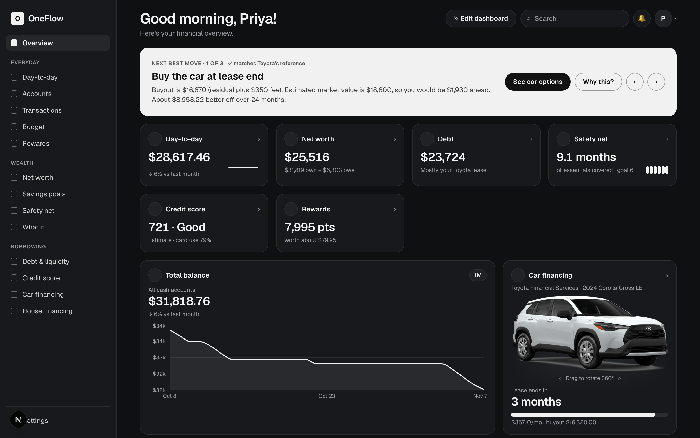
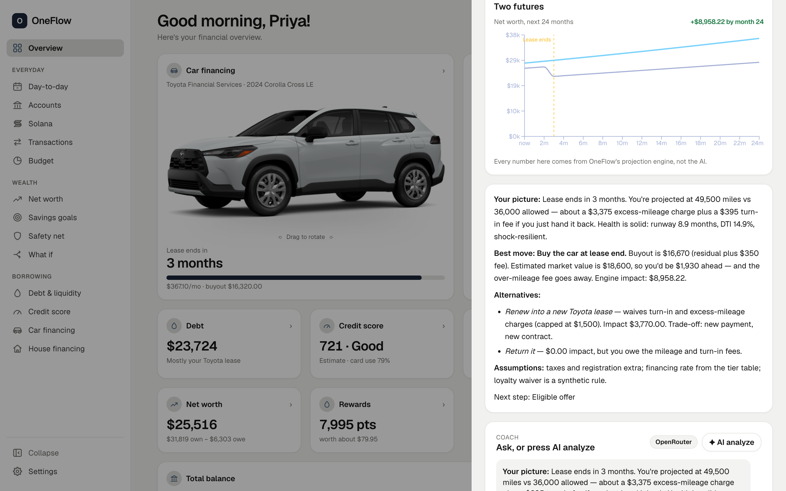
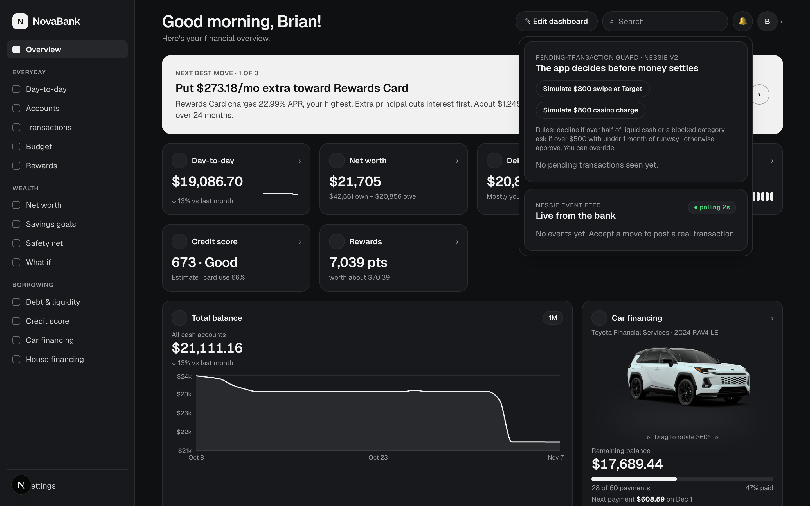
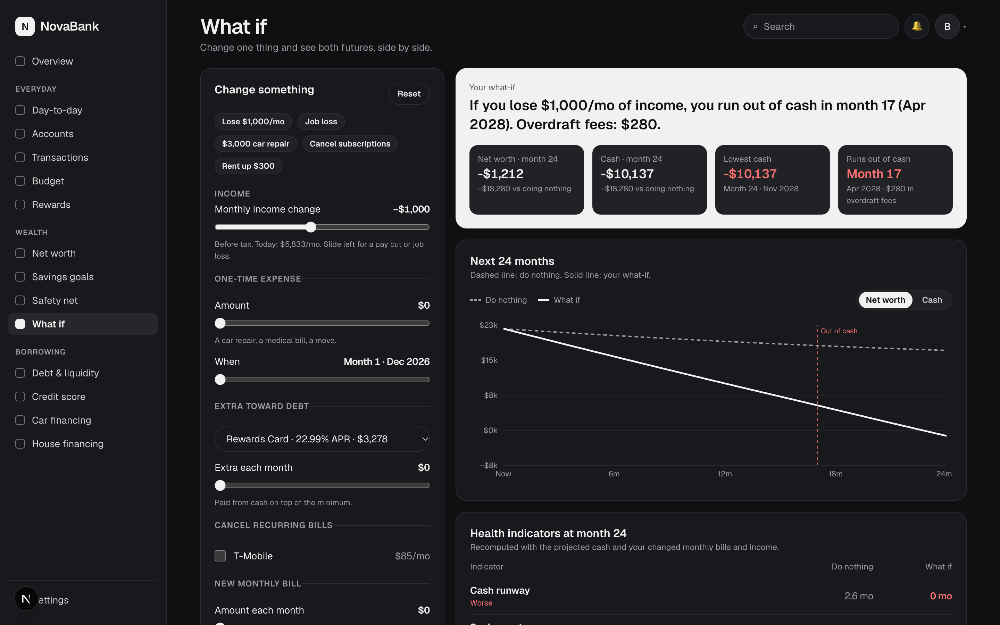
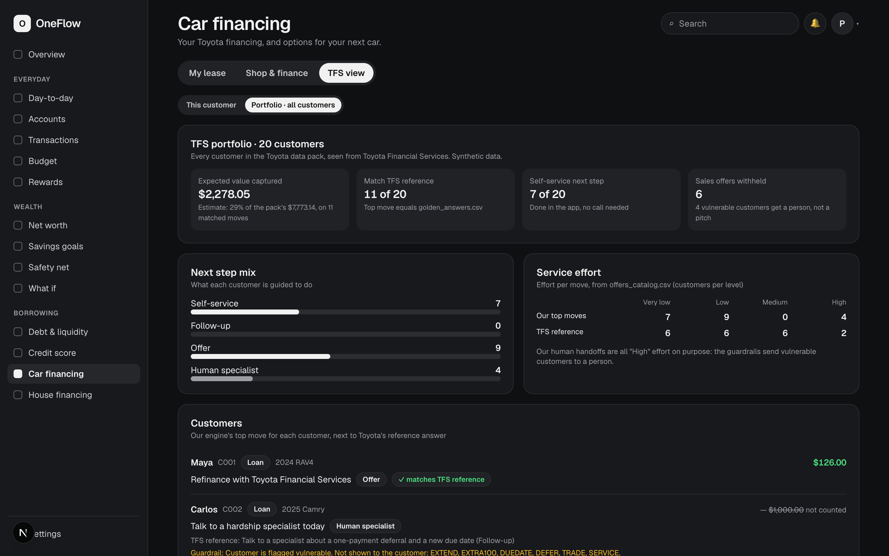
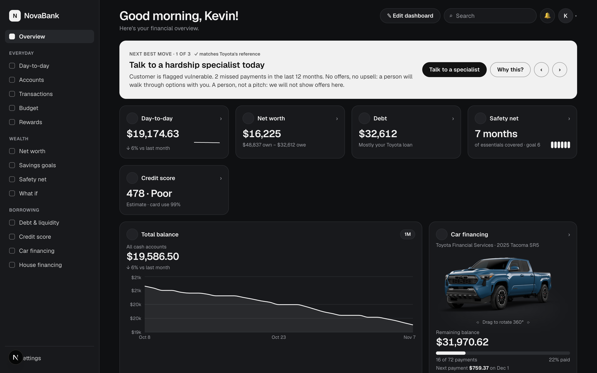
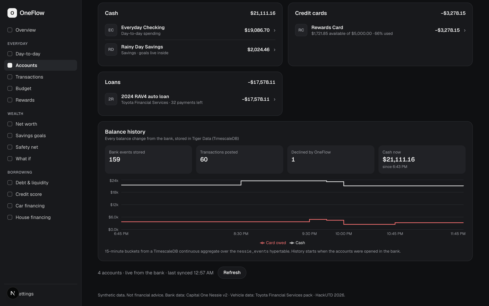

# OneFlow

**One Financial World. OneFlow.**

Your bank already knows your money. Ours also knows your car, and tells you the one thing to do next.

Live: **https://www.one-flow.us** · Built in 24 hours at HackUTD 2026: Zero Day



## The problem

Priya's car lease ends in three months. She has about $32k across checking and savings, a credit card she runs hot, and a few subscriptions she forgot about. Her bank shows her balances. Toyota sends her a lease-end letter. Neither one tells her what to actually do.

Should she buy the car, renew, or hand it back? Pay down the card first? Is she fine if her income drops? Answering that today means three apps, a spreadsheet, and a guess.

OneFlow answers it on one screen. In her case it says: **buy the car at lease end, about $8,958 better off in 24 months.** That matches Toyota's own reference answer for her.

## What it does

1. **Builds your whole picture.** Checking, savings, CDs, card and your Toyota loan or lease, pulled from a real (sandbox) bank: Capital One's Nessie.
2. **Ranks your next moves by dollars.** A plain TypeScript engine projects your next 24 months and scores every option: pay down the card, build a safety net, cancel subscriptions, refinance or buy out the car.
3. **Shows you both futures.** *Why this?* draws "do nothing" next to "do this", with the lease end marked.
4. **Explains it in plain English.** An AI coach narrates what the engine found. It is not allowed to do arithmetic, so it can't make numbers up.
5. **Does it for you.** Accepting a move sends a real transaction through the bank, and you watch it settle in the live feed.
6. **Protects you before money leaves.** Every pending card charge is checked by our rules before it settles. An $800 Target swipe that fits your budget is approved. An $800 casino charge is declined, and the bank releases the hold.
7. **Knows when not to sell.** A customer flagged as vulnerable with missed payments gets one card: talk to a specialist. No offers, no upsell.

| | |
|---|---|
|  |  |
| *Why this?* Two futures, and a coach that explains but never calculates | The guard decides card holds before they settle |
|  |  |
| What if Brian lost $1,000 a month? Out of cash in month 17 | Toyota's view: 20 customers, 11 match their reference answer |
|  |  |
| Guardrails in code: a person, not a pitch | Balance history the bank itself doesn't give you |

## How each track is answered

**Capital One: Best Use of Nessie.** Nessie isn't a data source we read once. It is the bank.
- Twenty customers are seeded with accounts, paychecks, purchases, bills and loans.
- Moves execute as real transfers, card payments, new bills and cancelled subscriptions.
- *Send money* pays another OneFlow customer, and the receipt shows Nessie's own transaction id.
- The guard decides pending holds with `POST /transactions/{id}/decision`.
- A signed, de-duplicated decision webhook (with a registration script) lets Nessie ask us directly before a purchase settles.
- A fraud monitor runs our own detectors over Nessie's historical simulation.

**Toyota Financial Services: What's Your Next Move?**
- *Personalize:* each of the 20 customers in Toyota's data pack drives their own vehicle, contract and situation.
- *Simplify:* every option shows the payment, the total cost against keeping things as they are, the assumption and the trade-off.
- *Guide:* every move ends in a next step: self-service, a follow-up, or an eligible offer. "No eligible offer" is an allowed answer.
- *Value:* a portfolio view shows all 20 customers from Toyota's side.
  - Our top move matches their reference answer for **11 of 20**.
  - Those matches carry **$2,278 of the pack's $7,773** expected value.
  - Seven customers finish in self-service.
  - Six sales offers are held back from vulnerable customers.

**PNC: 360° Financial Health Navigator.**
- One view across every account type in the bank.
- Eight health indicators, reimplemented from PNC's workshop package.
- A 24-month forecast of balances and obligations.
- A coach grounded in the engine.
- An open **What-if simulator**: change your income, add a one-time expense, put extra toward a debt, cancel real bills or add a new one, and see both futures, your lowest cash point and which indicators get worse.

**Also:**
- **MLH Solana:** connect a Devnet wallet alongside bank accounts, review USDC payments against a clearly labeled demo budget, approve in the wallet, and see server-verified receipts in Transactions. Receipts show actual network fees and measured submission-to-verification time. [Successful 1-USDC Devnet payment](https://explorer.solana.com/tx/3SWY7KHErQBrxzp4st6bEGqMU7LwdYKZobc1xHz6jeAKvFoNvnXHwsrF4R7P8tNbzz94sSKza1GCaYG9dXzaQGPk?cluster=devnet).
- **HackUTD Design:** built from our own desktop and mobile wireframes. Works at phone width.
- **MLH Gemini:** the coach's first choice of model.
- **MLH Tiger Data:** every bank event is streamed into a TimescaleDB time series.
- **MLH GoDaddy Registry:** one-flow.us.

## How we built it

**The engine decides, the AI explains, the bank executes.** That split is the whole design.

| Layer | What it does | Tech |
|---|---|---|
| Engine | Normalizes the bank and Toyota data into one profile, projects 24 months, computes 8 health indicators, ranks moves, applies guardrails. Pure functions, integer cents everywhere | TypeScript |
| Bank | Real accounts and money movement, event feed, pending-transaction decisions | Capital One Nessie v2 |
| AI coach | Narrates the engine's tool results. Six approved tools; the one that moves money only asks you to confirm. Falls back Gemini → OpenRouter → an offline narrator, so the demo never breaks on a model outage | Gemini, OpenRouter |
| History | Every Nessie event goes into a hypertable; a 15-minute continuous aggregate gives each account a real balance history | Tiger Data (TimescaleDB) |
| Solana payments | Exact USDC units, wallet-approved transactions, recipient token-account creation, server-side transfer verification, and shared device receipts. Devnet funds stay separate from bank balances | Solana Kit, SPL Token, Wallet Standard |
| App | 17 pages, light and dark, phone and desktop | Next.js 16, React, Tailwind 4, Recharts, Vercel |

```
Toyota data pack ─┐                       ┌─ profile  → health, 24-month forecast, ranked moves
                  ├─ normalize → Profile ─┤
Nessie (bank)  ───┘                       ├─ execute  → real Nessie transfers / bills → live event feed
                                          ├─ coach    → tools → Gemini → OpenRouter → offline narrator
                                          ├─ guard    → POST /transactions/{id}/decision (approve / decline)
                                          ├─ p2p      → validated transfer to another customer
                                          └─ events   → shared poller → Tiger Data hypertable → balance history
```

369 automated tests cover the engine, the guard, the coach fallback, P2P, the portfolio, what-if and every API route.

## Challenges we ran into

- **The guard never fired.** We listened for `transaction.pending`, but Nessie announces a new card hold as `transaction.created` with status `pending`. Every swipe settled untouched until we caught it live. Now both event types count.
- **A lease isn't a loan.** Our first ranking treated a lease like debt and kept recommending the wrong thing. We model it as rent: no asset and no principal, with return fees and replacement transport in the "do nothing" baseline. That change is what made the ranking land on Toyota's answers.
- **One page load cost 11 bank calls** against a 120-per-minute limit that every visitor shares. A few judges clicking at once could stall the site. We added a shared event poller and a 15-second profile cache that clears whenever money moves.
- **Tiger signs its certificates with a private CA** that Node doesn't trust. Rather than turning off certificate checks, we pinned Tiger's root and kept full verification.
- **Nessie has no loan-payment endpoint.** Extra car payments are set aside in a labelled savings transfer instead of faking a payment.
- **A transfer showed as money out on both sides.** Nessie lists it under both accounts, so the receiving side now reads it as money in.

## What we're proud of

- Money really moves: payments, transfers, declines and released holds all happen in the bank, not in a mockup.
- Toyota's reference answers are matched by computation. The badge is never hard-coded, and we say why the other nine miss.
- Guardrails live in code, not in a prompt. A vulnerable customer never sees an offer, no matter what the model says.
- The demo survives a bank or model outage: bundled snapshots and an offline narrator.

## What we learned

Letting the model only narrate isn't a limitation, it's the product. Every number on screen traces back to a CSV row or a bank response, which is exactly what you want when the topic is someone's money.

## What's next

- Register the decision webhook so the bank asks us about every purchase, even with the app closed.
- A payoff-quote move for loans that are almost done.
- Save goals and dashboard edits on the server.
- Real Toyota Financial Services APIs in place of the data pack.

## Honest notes

- **Bank and vehicle data are synthetic.** Toyota's pack says so, and our bank data is generated from it. Solana balances and transactions are read from Devnet, where test tokens have no monetary value. Nothing here is financial advice.
- **Estimates are labelled.** Credit score is an estimate, not a bureau score, and the Toyota expected values come straight from the pack's own take rates.
- **What we don't model.** No customer has a mortgage, investments or insurance, so those pages are calculators or empty, never filled with fake data.
- **What the reference matches miss.** The nine customers whose top move differs from Toyota's do so for stated reasons:
  - our vulnerable-customer handoff overrides two of them
  - trade-ins have no modelled dollar impact
  - buyout beats renewal on equity
  - two moves rank below another option

## Run it

```bash
pnpm install
cp .env.example .env.local   # optional: Nessie, Gemini, OpenRouter, Tiger keys
pnpm dev                     # http://localhost:3000/?p=C003 (works with no keys: synthetic bank, offline narrator)
pnpm test
```

Switch customers with `?p=C001` … `?p=C020`, or from the avatar menu. Good ones to try:
- `C003` Priya: lease ending
- `C018` Brian: card debt
- `C014` Kevin: vulnerable

For Solana, open `/solana`, connect a Devnet wallet, fund it with free test SOL and test USDC, and send to a second wallet. Accounts shows the connected wallet; Day-to-day links to payments; Transactions shows receipts. The payment review compares spending with the selected synthetic profile's budget without modifying it. Devnet tokens have no monetary value, and receipts are saved in this browser. Optional RPC variables are documented in `.env.example`; no wallet private key is needed.

Browser checks use an ephemeral fixture wallet and mocked APIs: run `pnpm exec playwright install chromium`, then `pnpm test:browser` with the app running. Real on-chain proof is linked in the Solana track description above.

## Built with

TypeScript · Next.js 16 · React · Tailwind CSS 4 · Recharts · Zod · Vitest · Capital One Nessie v2 · Google Gemini API · OpenRouter · Tiger Data (TimescaleDB, PostgreSQL) · Vercel · GoDaddy Registry

## Credits

- **Capital One** Nessie v2 sandbox bank.
- **Toyota Financial Services** "Smartest Next Move" data pack (synthetic).
- **PNC** Financial Wellness workshop (devfulcrum/pnc-utd-hackathon-2026, Apache-2.0), for the health-indicator definitions. We reimplemented them; we didn't copy the code.
- **Car images** are Toyota's public model renders from toyota.com, used only for this Toyota-sponsored hackathon entry. They remain Toyota's property.
